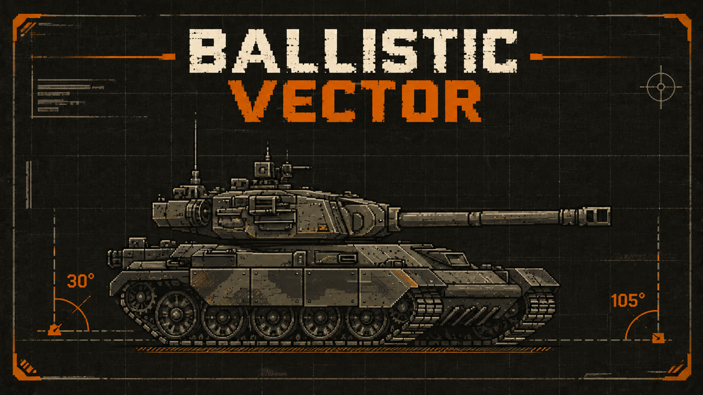
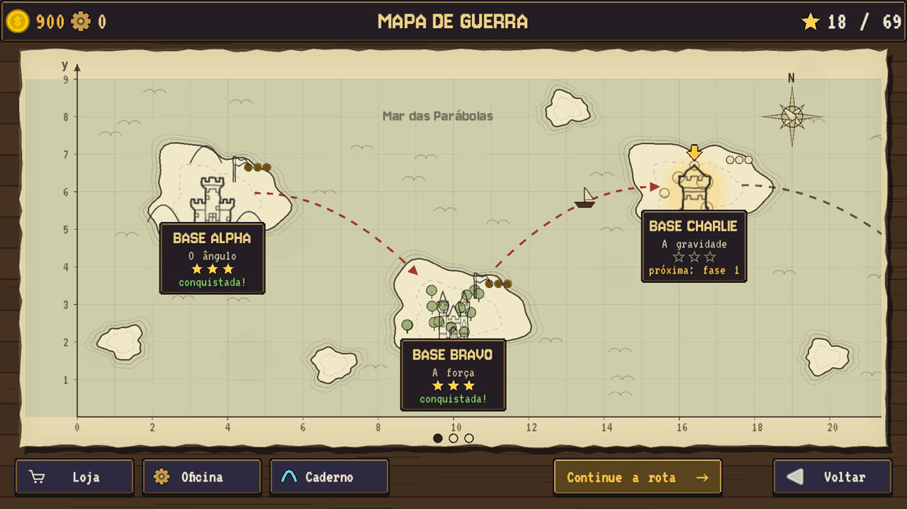
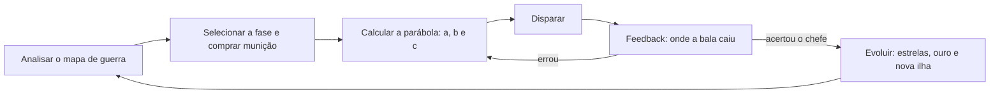
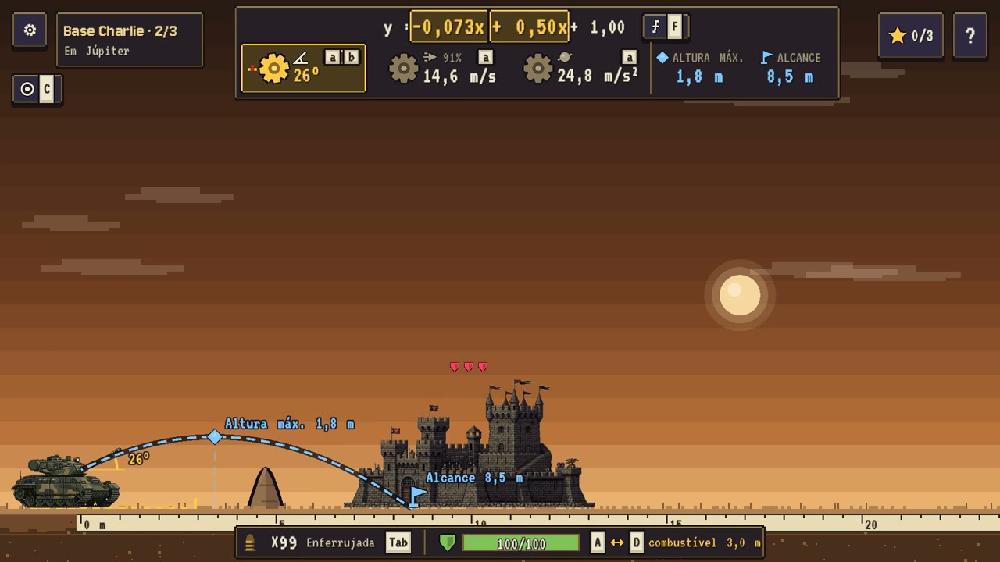
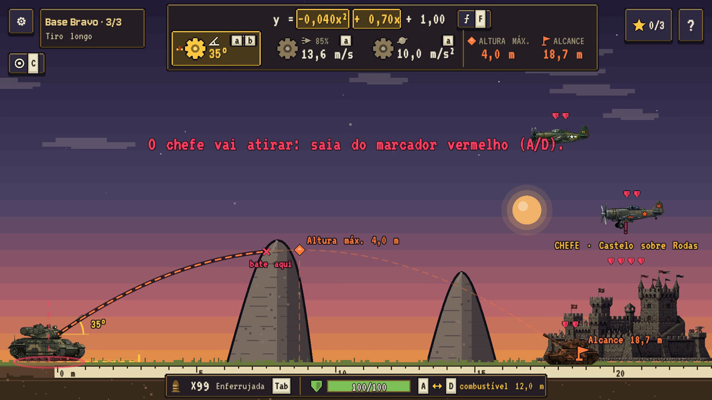
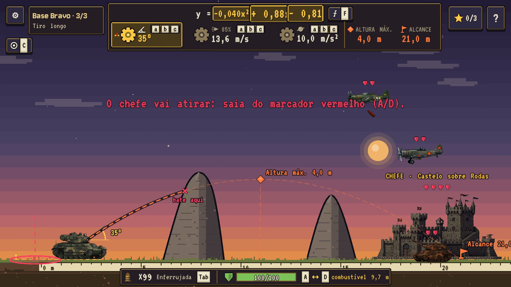

# Ballistic Vector — Game Design Document (v1.0, entrega N3)

**Equipe de desenvolvimento:** Gabriel Vinicius Colares Batista, Gabriel Chiarelli de Souza, Vinicius Pollnow Fernandes e Andre Ricardo Felipe dos Santos.

**Centro Universitário Católica de Santa Catarina — Joinville** · Engenharia de Software · Projeto de Aprendizagem Colaborativa Extensionista · Professor Diego Sauter Possamai.

> Esta é a versão em Markdown do GDD. O documento original, com a mesma estrutura, fica no Google Docs da equipe.

---

## 1. High Concept

Ballistic Vector é um jogo tático de artilharia singleplayer. O jogador opera o último tanque do arquipélago, que a Engenheira Ada consertou depois que um pulso eletromagnético queimou todos os computadores de mira. A experiência principal é ajustar, em tempo real, a função quadrática `f(x) = ax² + bx + c` para que a trajetória parabólica do projétil intercepte alvos inimigos, contorne montanhas e proteja o território aliado.

Diferente de um shooter tradicional, o jogo troca o foco da reação rápida pelo raciocínio matemático: dominar a álgebra é a única forma de vencer a guerra. A estética é pixel art de um arquipélago em guerra ao entardecer, com o mapa de campanha desenhado em papel. Sem computador, a mira é feita à mão, e isso reforça a fantasia de que cada disparo é planejado por cálculo.

O diferencial é integrar aprendizado matemático e gameplay num só gesto. Cada giro de engrenagem é ao mesmo tempo uma decisão tática e uma intuição visual sobre como os coeficientes deformam a parábola. A compreensão vem da repetição significativa, nunca de perguntas explícitas.

## 2. Visão geral do jogo (overview)

A tabela mostra os principais parâmetros de produção e posicionamento do Ballistic Vector. Esses dados orientam o público-alvo, o escopo técnico e as decisões de design.

| | |
| :- | :- |
| **Título** | Ballistic Vector |
| **Gênero** | Tático / Defesa de Base / Puzzle Educativo |
| **Plataforma** | PC (Windows e Linux) |
| **Público-alvo** | Estudantes do Ensino Médio (cerca de 16 anos) |
| **Classificação** | L — Livre |
| **Nº de jogadores** | 1 (singleplayer) |
| **Status de produção** | Versão 1.0.0 (entrega N3): campanha completa, tutorial guiado e builds para Windows e Linux |
| **Engine / Tecnologia** | Godot 4.6.3 |
| **Tempo médio de sessão** | 10 a 20 minutos por missão |
| **Tema sério abordado** | Educação Matemática — Funções Quadráticas (Álgebra) |

O projeto se posiciona no nicho de edutainment matemático. A inspiração estética vem de jogos como Return of the Obra Dinn (paleta restrita e atmosfera de documento técnico). A mecânica se inspira em clássicos de artilharia (Worms, Scorched Earth), mas mostra a abstração algébrica em vez de escondê-la sob barras de potência e ângulo.

## 3. Design goals (objetivos de design)

Os objetivos abaixo orientam as decisões de design, arte e código do projeto. Eles servem de filtro: toda mecânica nova precisa atender a pelo menos um deles.

### O que o jogo busca

- **Educação prática:** tornar o cálculo de funções quadráticas intuitivo e jogável, transformando coeficientes abstratos em decisões com consequências visuais imediatas.
- **Desafio tático:** unir a precisão balística ao gerenciamento estratégico de território, exigindo que o jogador decida quais ameaças atender primeiro.
- **Imersão visual:** criar a sensação de operar um caderno de engenharia steampunk, em que cada tela parece uma página técnica anotada à mão.
- **Raciocínio sobre reflexo:** valorizar o jogador que pensa, erra e ajusta, e não o que clica rápido.
- **Acessibilidade matemática:** permitir que um estudante sem domínio prévio entenda intuitivamente o papel de a, b e c só observando o efeito de cada ajuste.

### O que o jogo evita

- **Provas disfarçadas:** o jogo nunca pergunta "qual o valor de a?" nem exige respostas digitadas. O aprendizado acontece pelo fazer.
- **Punição arbitrária:** errar um disparo faz parte do loop. O jogador pode ajustar e tentar de novo sem perder progresso de forma traumática.
- **Sobrecarga visual:** a HUD é limpa e integrada à estética de caderno técnico.
- **Dependência de leitura intensa:** tutoriais textuais longos dão lugar a anotações curtas e demonstrações visuais.

## 4. Core gameplay (mecânicas principais)

O jogador alterna entre dois modos conectados: o Mapa Estratégico, onde toma as decisões gerais, e o Combate, onde faz o ajuste balístico.

### Modo Mapa Estratégico

- **Escolher a base:** o mapa de guerra é um pergaminho com plano cartesiano, e cada base inimiga fica numa ilha com coordenadas. As bases abrem em ordem (Alpha, Bravo, Charlie, Delta, Echo, Foxtrot e Norte), cada uma com três fases. A Ilha Invertida (bônus) abre junto com a Foxtrot. No Modo Professor, todas ficam abertas.
- **Preparar a munição:** o ouro ganho em combate compra munição na loja: a Enferrujada e a Perfurante, cada uma com o seu dano e, na Terra, a sua própria gravidade. Sem munição e sem ouro, o mapa entrega um kit de emergência.
- **Acompanhar o progresso:** ao conquistar uma base, um barco navega pela rota em arco de parábola até a próxima ilha, e medalhas e estrelas mostram o que já foi retomado.

### Modo Combate Balístico

- **Girar a engrenagem do ângulo:** levanta ou abaixa o canhão e mexe no a e no b da equação. O `b = tg θ` é a inclinação da curva na saída: mais ângulo dá um arco mais alto, útil para passar por cima das montanhas.
- **Girar a engrenagem da força:** muda a velocidade de saída e, com ela, só o a. Mais força deixa o a mais perto de zero, abre a parábola e leva o tiro mais longe com o mesmo ângulo.
- **Gravidade, altura e translação:** a terceira engrenagem é a gravidade, que na Terra muda com a munição (Tab) e nos planetas é a do planeta. O c é a altura da boca do canhão. Nas fases com combustível, andar com A/D desloca a parábola inteira e muda a, b e c de uma vez.
- **Pré-visualizar a trajetória:** a curva tracejada aparece em tempo real enquanto o jogador gira as engrenagens. Junto com ela aparecem o vértice (altura máxima), a raiz (alcance) sobre uma régua em metros e o ponto onde a bala bate numa montanha. A tecla F abre a conta por trás da curva, e o Modo chute (C) esconde a curva para quem quer calcular sozinho.
- **Confirmar o disparo:** com a barra de espaço, o projétil percorre a parábola configurada e colide com terreno, obstáculo ou alvo: aviões, balões, bunkers, tanques inimigos e o castelo-chefe.
- **Recalibrar após o erro:** se o tiro falha, o jogador vê onde a bala caiu e refaz a conta. Depois de três erros seguidos, a Ada dá uma dica. O erro é a principal ferramenta pedagógica.

## 5. Core game loop

O loop principal estrutura toda a experiência. Ele é jogável e repetível, e cada ciclo completo gera um progresso visível na campanha: estrelas, ouro e uma nova ilha retomada. O loop tem duas camadas: o macro-loop da campanha e o micro-loop de tentativa dentro de cada missão.

### Descrição textual do loop principal

**Analisar** o mapa de guerra e escolher a próxima base → **Selecionar** a fase, comprar munição e entrar no combate → **Calcular** a parábola ideal ajustando os coeficientes a, b e c → **Disparar** o projétil ao confirmar a trajetória → **Receber feedback** visual e textual sobre precisão e impacto → **Evoluir** retomando a ilha e desbloqueando a próxima base → repetir.

*Fig. 1 — Core game loop do Ballistic Vector.*

### Micro-loop de tentativa (dentro de uma missão)

Dentro de cada combate há um ciclo mais curto: Calcular → Disparar → Feedback → Recalibrar → Disparar de novo. É nesse micro-loop que o aprendizado acontece. Errar não é punição, é o gatilho que ensina, porque cada erro mostra visualmente como ajustar a, b e c na próxima tentativa.

## 6. Sistemas do jogo

A arquitetura é modular: cada sistema tem uma responsabilidade clara e se comunica com os outros por sinais bem definidos. A tabela descreve os sistemas implementados na versão 1.0.0, com a prioridade que tiveram no projeto. Além deles, o jogo tem o tutorial guiado, o Laboratório (modo livre, com a tabela de pontos x e y) e o Modo Professor, que libera todas as bases e abre a conta para mostrar em aula.

| Sistema | Descrição funcional | Prioridade |
| :- | :- | :- |
| **Combate Balístico** | Núcleo do jogo. Permite ajustar em tempo real os coeficientes a, b e c da função `f(x) = ax² + bx + c`. A curva resultante aparece sobre o cenário antes do disparo, e o projétil segue essa parábola até colidir com terreno, obstáculo ou alvo. | Alta |
| **Mapa Estratégico** | Hub da campanha. Um pergaminho com plano cartesiano em que cada base é uma ilha com coordenadas e as rotas são arcos de parábola. As bases abrem em ordem, e a Ilha Invertida abre junto com a Foxtrot. | Alta |
| **Progressão de Território** | Cada base tem três fases, e cada fase vale até 3 estrelas: a primeira por vencer e as outras por desafios matemáticos (ângulos complementares, vértice numa faixa de altura, um balão subindo e outro descendo). Vencer rende ouro para a loja. O progresso é salvo automaticamente. | Alta |
| **IA Inimiga** | Aviões patrulham, bombardeiam e desviam das montanhas; tanques inimigos andam e revidam; drones voam em linha reta na Foxtrot. Cada chefe tem uma regra (escudo, castelo que anda, que pula, gravidade própria, guarda), e os da Bravo 3 e da Delta 3 atiram um morteiro avisado por um marcador. | Média |
| **HUD Educativo** | Mostra a equação `y = ax² + bx + c` com os números da fase, as três engrenagens com os chips dos coeficientes que cada uma altera, a altura máxima (vértice) e o alcance (raiz). A tecla F abre a conta completa, com Bhaskara. | Alta |
| **Variáveis Ambientais** | Gravidade da Lua, de Marte e de Júpiter, gravidade invertida na Ilha Invertida, gelo que faz a bala quicar na Base Norte e montanhas que bloqueiam a linha de tiro. | Média |
| **Sistema de Feedback** | Antes do tiro, a curva mostra onde a bala bate e a faixa onde ela pode cair. Depois de três erros seguidos, a Ada dá uma dica, sem nunca dar a resposta pronta. O resultado da fase mostra as estrelas e os desafios cumpridos. | Alta |

### Detalhamento do sistema central: Combate Balístico

O Combate Balístico é o coração técnico do projeto. Ele recebe o ângulo, a força e a gravidade vindos das engrenagens e calcula os coeficientes em `scripts/ballistics.gd`. Com o tanque na origem, `a = −g / (2v² cos² θ)`, `b = tg θ` e c é a altura do canhão. Quando o tanque anda, a parábola é transladada e a equação, expandida. A curva é desenhada tracejada, com o vértice (`−b/2a`) e a raiz (Bhaskara). A escala é única, 50 px = 1 m, então o número do painel é o mesmo da régua.

O projétil não usa corpo rígido: ele integra a própria física, com a velocidade de saída e a gravidade da munição ou do planeta. Os testes automáticos garantem que a bala real cai onde a HUD diz e que todo alvo de toda fase é atingível. Cada colisão com terreno, obstáculo ou alvo emite um sinal (acerto, falha ou dano) que atualiza a fase e a HUD.

## 7. Mundo / ambiente

O jogo se passa num arquipélago em guerra, de inspiração militar do século XX: aviões de hélice, fortalezas de pedra e tanques. Numa noite, o Comando Norte tomou as ilhas: um pulso eletromagnético queimou todos os computadores de mira da frota, e as fortalezas viraram castelos inimigos. Cada base da campanha é uma ilha. O mapa de guerra é um pergaminho com plano cartesiano, porque não sobrou computador para mostrar outro.

### Tipos de cenário

- **Bases Alpha e Bravo:** ilhas de terreno aberto e montanhas baixas, onde o jogador aprende o ângulo (Alpha) e a força (Bravo). A Bravo 3 traz o primeiro chefe que atira de volta.
- **Base Charlie:** a gravidade muda. As fases se passam na Lua, em Marte e em Júpiter, com a mesma conta e uma parábola de outro formato.
- **Base Delta:** a translação. O tanque anda com combustível e a parábola se desloca junto. O chefe da Delta 3 também revida.
- **Base Echo:** o vértice e o delta. Uma linha `y = h` aparece no mundo, e o jogo mostra se a parábola a cruza 2, 1 ou 0 vezes.
- **Base Foxtrot:** a parábola e a reta. Drones voam numa rota `y = mx + n`, e o tiro precisa cruzar a rota no ponto certo.
- **Base Norte:** o gelo. A bala quica, e cada quique é uma parábola nova.
- **Ilha Invertida (bônus):** gravidade para cima, `a > 0` e parábola de boca para cima, com o vértice como ponto mínimo.

### Ambientação

Os cenários são em pixel art, com céu de entardecer em camadas, ilhas rochosas e castelos de pedra. O que o jogo calcula (a curva, o vértice, a raiz e a régua em metros) aparece desenhado sobre o cenário, como as anotações de um engenheiro de campo.

## 8. Narrativa / contexto

### Premissa

> O Comando Norte tomou o arquipélago em uma noite: um pulso eletromagnético queimou todos os computadores de mira da frota. As fortalezas que a Engenheira Ada projetou viraram castelos deles, blindados contra o pulso. Os nossos canhões viraram sucata. Ada consertou o último que restou: o seu tanque. Sem computador, ele só dispara com a conta certa. Ela sabe onde cada castelo falha. O resto é cálculo.

### A protagonista: Engenheira Ada

A Engenheira Ada projetou as fortalezas do arquipélago antes da guerra e por isso conhece a falha de cada uma. As regras dos chefes (escudo, castelo que anda, que pula, gravidade própria, guarda) são essas falhas de projeto. O jogador opera o tanque que ela consertou. Ada acompanha cada fase com uma frase curta e direta da lição e só dá uma dica depois de erros seguidos. O Laboratório é a oficina dela. A história é contada em quatro telas ilustradas no começo da campanha (e no botão TUTORIAL), sem cutscenes longas.

### Conflito principal

Retomar, ilha por ilha, as fortalezas do Comando Norte com o único canhão que ainda funciona. Os canhões dos castelos sobreviveram ao pulso, e os chefes da Bravo 3 e da Delta 3 atiram de volta. Sem computador de mira, cada tiro depende de uma conta feita à mão. O cálculo vira ferramenta: um tema sério integrado à gameplay, e não pregado pelo roteiro.

## 9. Direção de arte

### Estilo visual

A identidade visual é pixel art: arquipélago ao entardecer, tanque verde-oliva, castelos de pedra e a Engenheira Ada em retrato. O mapa de guerra mantém a herança do caderno de engenharia: um pergaminho com plano cartesiano sobre a mesa de comando. A paleta vem dos próprios assets: céu roxo, laranja e rosa de entardecer, verde-oliva do tanque, pedra dos castelos e papel do mapa. Três cores de destaque têm um só significado em todo o jogo: âmbar para o que o jogador pode mudar, a cor da mira para o que o jogo calculou e carmim para perigo.

### Referências visuais

- **Return of the Obra Dinn:** paleta e textura restritas para criar atmosfera de documento técnico.
- **Cadernos de Leonardo da Vinci:** anotações manuscritas e diagramas técnicos com setas e marcações.
- **Cartografia militar do século XIX:** perfis de elevação e mapas estratégicos com hachuras e legendas.
- **Estética steampunk industrial:** engrenagens, válvulas e mostradores analógicos para controlar os coeficientes.

### Interface (UI)

A UI é em pixel art, com moldura de latão, rebites e sombra dura. As engrenagens giram com as setas ou com o mouse, como uma manivela. Os botões são ícones com a tecla desenhada (ƒ com F, munição com Tab, A/D para andar, alvo com C), e o mapa de guerra é um pergaminho com plano cartesiano. A vida do tanque aparece numa barra, e a dos castelos, em corações. O texto usa VT323, com dígitos sem ambiguidade, e os títulos usam Jersey 10.

## 10. Áudio (som e música)

### Trilha sonora

São duas faixas instrumentais em loop contínuo, controladas pelo `AudioManager`: uma música de fundo calma no menu e no mapa de guerra, para planejar, e uma trilha de batalha a 120 BPM na arena, que dá tensão ao combate sem cobrir o som do tiro. O volume da música e dos efeitos se ajusta no menu de pausa.

### Efeitos sonoros (SFX)

- **Menus:** clique, foco e voltar nos botões do menu, do mapa e da loja.
- **Erro:** um aviso curto quando a ação não é possível: engrenagem no limite, tiro sem munição ou compra sem ouro.
- **Disparo:** estouro de canhão a cada tiro.
- **Impacto:** som de impacto quando a bala acerta um alvo ou o castelo.
- **Para uma versão futura:** som por tipo de superfície, sino no acerto perfeito e alarme antes do morteiro do chefe.

### Ambientação sonora

Na versão 1.0.0 não há uma camada de ambiente separada: a faixa de cada tela faz esse papel. Vento, papel e um relógio ao fundo, para dar a sensação de uma sala de comando, ficam como ideia para uma versão futura.

## 11. Gameplay example (exemplo de jogabilidade)

Uma situação concreta mostra como os sistemas se integram.

### Situação: Bravo 3, "Tiro longo", contra o Castelo sobre Rodas

No mapa de guerra, a Base Bravo já tem duas fases conquistadas. O jogador compra balas Perfurantes na loja com o ouro das fases anteriores e abre a Bravo 3, "Tiro longo". A Ada abre a fase com uma frase só, avisando que o chefe atira de volta.

A arena mostra o tanque à esquerda, sobre uma régua em metros; duas montanhas no caminho; e, a uns 22 m, o Castelo sobre Rodas, com 4 corações, andando de um lado para o outro. Dois aviões patrulham o céu, e um tanque inimigo guarda o castelo. A HUD mostra `y = −0,040x² + 0,70x + 1,00`, com o ângulo em 35°, a força em 85% (13,6 m/s) e a gravidade em 10,0 m/s². O alcance é de 18,7 m, e o tanque tem 12 m de combustível.

A curva tracejada marca "bate aqui" na primeira montanha: com 35°, o tiro não passa. O jogador levanta o canhão: o b sobe, a curva fica mais alta e passa a montanha, mas ainda cai antes do castelo. Então gira a força: só o a muda, a parábola abre e a raiz chega ao castelo. Antes do tiro, surge um marcador vermelho sob o tanque e o aviso "O chefe vai atirar: saia do marcador vermelho (A/D)."

O jogador anda com D para sair do marcador, e a parábola inteira se desloca junto: a, b e c mudam na equação (translação). O morteiro cai onde o tanque estava. Com a curva de volta no castelo, ele atira com Espaço; o castelo racha e perde um coração. Como o castelo anda, a conta muda a cada tiro. No quarto acerto o castelo cai, a fase mostra as estrelas dos desafios cumpridos e, no mapa, um barco navega até a Base Charlie, onde a gravidade muda.

## 12. Tema e elementos sérios

### Qual tema está sendo abordado

O Ballistic Vector aborda Educação Matemática, especificamente as Funções Quadráticas (parábolas), tema central do currículo do 9º ano do Ensino Fundamental e do 1º ano do Ensino Médio no Brasil. O jogo trabalha a intuição visual sobre o efeito dos coeficientes a, b e c na forma da parábola, um conceito abstrato que costuma ser fonte de dificuldade para os estudantes.

### Como o tema aparece no jogo

Não há perguntas, quizzes nem avaliações, e o jogador nunca precisa "responder" nada. O aprendizado acontece por descoberta: ao girar uma engrenagem e ver a curva mudar na hora, o jogador associa o valor numérico ao comportamento do gráfico. Depois de uns dez disparos, ele já antecipa sozinho: "preciso de um arco mais fechado, então aumento o a", sem nunca ter recebido essa instrução.

### Como é integrado à gameplay

- **Mecânica = conteúdo:** ajustar os coeficientes é o próprio ato de jogar, e não uma camada educativa por cima de outro gameplay.
- **Feedback diegético:** a curva, o vértice, a raiz e o ponto onde a bala bate aparecem no próprio cenário. A dica da Ada só vem depois de erros seguidos e nunca dá a resposta pronta: o jogo ensina pelo erro.
- **Progressão pedagógica:** cada base ensina uma ideia. Alpha, o ângulo (b); Bravo, a força (a); Charlie, a gravidade em outros planetas; Delta, a translação; Echo, o vértice e o delta (quantas vezes a parábola cruza uma reta `y = h`); Foxtrot, a parábola e a reta (drones numa rota `y = mx + n`); Norte, o gelo, em que cada quique é uma parábola nova; e a Ilha Invertida, com `a > 0` e o vértice como ponto mínimo.
- **Aprendizado por repetição significativa:** cada tentativa, mesmo a que falha, gera informação visual que o jogador internaliza, um mecanismo que a pedagogia chama de aprendizagem por descoberta guiada.

### O que o jogo não faz (por princípio de design)

- **Não pergunta diretamente ao jogador:** nunca há um diálogo do tipo "qual é o valor do vértice?".
- **Não exige respostas:** não existe campo de texto, escolha múltipla nem validação acadêmica.
- **Não interrompe o jogo para ensinar:** o tutorial é opcional (botão TUTORIAL), mostra uma mecânica por página e termina numa prática jogável. Dentro da fase, a Ada fala uma frase só.
- **Não pune o erro:** errar faz parte do mecanismo educativo, e o jogador pode tentar quantas vezes quiser dentro da missão.

## 13. Ajustes pós-feedback (N3)

Depois da avaliação do protótipo, a ficha técnica e o feedback do professor apontaram sete pontos. A tabela resume o que mudou entre a versão 0.7.0 e a 1.0.0.

| Ponto do feedback | Antes (v0.7.0) | Depois (v1.0.0) |
| :- | :- | :- |
| 1. Enredo | O jogo não contava história; a Ada só abria as fases. | Enredo em quatro telas ilustradas (o pulso, a tomada, a oficina, a conta), mostrado na primeira campanha e no botão TUTORIAL. |
| 2. Tutorial | Falas da Ada dentro da fase, uma depois da outra, sem ilustração. | Modal centralizado com fundo escurecido, uma mecânica por página, ilustrações em fundo branco (tanque, parábola), lista de teclas em ícones, confirmação ao sair e prática final contra um chefe de 1 HP. |
| 3. HUD com menos texto | Rótulos escritos, como "Ângulo ab" e "Ver conta (F)". | Ícones com a tecla desenhada no botão: ƒ com F, munição com Tab e A/D para andar. Cada engrenagem mostra os chips a, b e c dos coeficientes que altera. |
| 4. Inimigos e chefes | Poucos inimigos por fase, e os chefes não reagiam. | Tanque inimigo na Alpha 2, balão na Alpha 3 e os chefes da Bravo 3 e da Delta 3 atirando um morteiro avisado por um marcador. |
| 5. Mobilidade | As primeiras fases (Alpha) não deixavam o tanque andar, e o chefe não dava motivo para se mexer. | Combustível já na Alpha 2 e na Alpha 3 (3 m) e 12 m na Bravo 3, para andar com A/D e sair do tiro do chefe. |
| 6. Falas da Ada | Aberturas com várias falas seguidas (7 na Alpha 2). | No máximo uma frase da lição e um aviso de chefe por abertura, em texto direto, sem "!" e sem diminutivos. A dica só aparece depois de erros seguidos. |
| 7. Fonte | Texto apertado: pouca entrelinha e pouco espaço entre as palavras. | Entrelinha de 8 px e 4 px a mais entre as palavras em todo o jogo (tokens `LINE_SPACING` e `WORD_SPACING`). |
